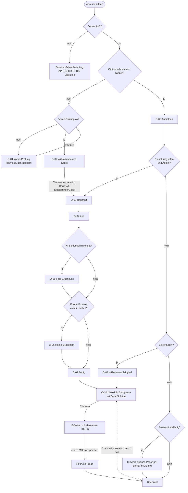

# Preposaurus – Onboarding-Konzept

> Stand 2026-11-22 · Entwurf des Strangs **Onboarding** · Abgleich über `SCHNITTSTELLEN.md`.
> Grundlage: `05_STATUS_ENTSCHEIDUNGEN.md` (verbindlich), `UX_KONZEPT.md` (§6–§8, §11), `EINSTELLUNGEN_NUTZER.md` (§2–§4), `02_HAUSHALT_ZIEL.md`, `04_EINSTELLUNGEN.md`, `features.html` (ERS, HH, ZIEL, PWA), `technik.html` (Sicherheit, Vorschau Einrichtung), `UMSETZUNG.md` (M3-03, M3-09), Issue #1.
> Legt nichts Visuelles fest. Alle Zahlen in Beispielen sind erfunden.

**Inhalt:** 1 Leitlinien · 2 Ersteinrichtung · 3 Weitere Nutzer · 4 Leere Zustände und erste Schritte · 5 Lernen im Gebrauch · 6 Technisches Onboarding · 7 Ablauf und Screens · 8 Folgen für Daten, Design, Einstellungen · 9 Offene Fragen

## Kurzfassung

- **Vier Schritte, unter 2 Minuten:** Konto · Haushalt · Ziel · Home-Bildschirm. Pflicht ist nur Schritt 1, Schritt 2 ist mit „1 Erwachsene:r“ vorbelegt und mit einem Tipp erledigt. Alles andere hat einen Standard.
- **Keine Tour.** Die App erklärt sich dort, wo etwas zum ersten Mal passiert, in einer Zeile. Jeder Hinweis verschwindet für immer, sobald er bestätigt oder die Sache dreimal gelungen ist.
- **Keine „0 Tage“ als große Zahl.** Solange Essen oder Wasser fehlt, zeigt die Übersicht eine **Startphase**: das Ziel, was schon da ist, und den einen nächsten Schritt.
- **Neue Mitglieder** melden sich mit Benutzername und dem Passwort vom Admin an und landen nach einer einzigen Willkommensseite auf der Übersicht.
- **Technik:** Was zum Starten fehlt, steht im Container-Log (Server startet nicht). Was nur Funktionen abschaltet, sagt die App selbst, ruhig und mit dem nächsten Schritt.

---

## 1. Leitlinien

| Nr. | Leitlinie | Folge |
|---|---|---|
| L1 | **Erst die Zahl, dann die Details** | Abgefragt wird nur, was für die erste Rechnung nötig ist. Alles andere steht in den Einstellungen oder in „Erste Schritte“ |
| L2 | **Jeder Schritt hat einen Standard** | Wer nur „Weiter“ tippt, hat eine sinnvolle Einrichtung: 1 Erwachsene:r, BBK/BLE, 10 Tage, kein Zieldatum, alles essen, Foto-Erkennung aus |
| L3 | **Nichts geht verloren** | Abbruch nach Schritt 1: Beim nächsten Anmelden geht es am offenen Schritt weiter |
| L4 | **Dieselben Formulare** | Die Schritte nutzen die Formulare aus den Einstellungen (M3-07, M3-08). Was hier steht, ist später an genau einer Stelle änderbar |
| L5 | **Lernen im Gebrauch statt Tour** | Kein Overlay, keine Folien, kein „Weiter, Weiter, Fertig“ |
| L6 | **Ruhiger Ton** | Kein Ausrufezeichen, kein „Achtung“, keine Krisenbilder. Leere ist ein Anfang, kein Mangel |
| L7 | **Ehrlich** | Keine Beispieldaten, kein geschönter Wert. Was fehlt, wird benannt, ohne zu drängen |

---

## 2. Ersteinrichtung nach der Installation (ERS-01, PWA-02)

### 2.1 Wer richtet ein?

- **Wer die App als Erster öffnet, wird Admin** (ERS-01, `EINSTELLUNGEN_NUTZER.md` §2). Im Tailnet ist das vertretbar, die Einrichtungsanleitung (Issue #1) sagt: direkt nach `docker compose up -d` einrichten.
- Solange kein Nutzer existiert, zeigt jede Adresse die Einrichtung statt der Anmeldung. Danach ist sie nicht mehr erreichbar, auch nicht bei zwei gleichzeitigen Aufrufen (M3-03).
- Die Einrichtung geht am Handy und am PC gleich. Empfohlen wird kein Gerät, beides dauert gleich lang.

### 2.2 Die Schritte

| Schritt | Inhalt | Pflicht | Standard | Begründung |
|---|---|---|---|---|
| **0 Vorab-Prüfung** | nur sichtbar, wenn etwas fehlt (siehe §6.2): unverschlüsselte Adresse, Datenbank, Schlüssel | – | – | Fehler vor dem Anlegen eines Kontos zeigen, nicht danach |
| **1 Willkommen und Konto** | Ein Satz zur App, darunter Anzeigename, Benutzername, Passwort mit „Anzeigen“-Knopf | **ja** | Benutzername aus dem Anzeigenamen vorgeschlagen („Alex Beispiel“ → `alex`) | Ohne Admin kein Haushalt. Keine E-Mail (Maintainer-Entscheidung). Regeln aus `EINSTELLUNGEN_NUTZER.md` §4.4 |
| **2 Haushalt** | „Für wen plant ihr?“ Zähler Erwachsene · Kinder (bis 12) · Babys. Darunter klein: „Jugendliche und Senior:innen“ öffnet zwei weitere Zähler. Schalter „Ich zähle selbst mit“ | ja, aber ein Tipp genügt | 1 Erwachsene:r, „Ich zähle selbst mit“ an | Bedarf braucht Personen. Für den Modus „Offiziell“ reicht der Typ, Namen und Geburtsjahre kommen später |
| **3 Ziel** | „Wie lange soll euer Vorrat reichen?“ Chips 3 · **10** · 14 Tage · eigener Wert. Darunter „Bis wann?“ mit Chips „in 3 Monaten · bis Jahresende · später“. Quelle als Zeile: „Empfehlung: BBK/BLE, Stand …“ mit Link | nein | 10 Tage (Standard der Quelle), kein Zieldatum | Die Zahl braucht ein Ziel, das Datum nicht. Quelle sichtbar (ZIEL-01), aber nicht wählbar, es gibt im MVP nur eine |
| **4 Foto-Erkennung** | nur, wenn ein Schlüssel in der `.env` hinterlegt ist: „Fotos von Etiketten lesen lassen?“ mit dem Datenschutzsatz „Fotos gehen dafür an Anthropic (USA).“ Zwei gleich große Knöpfe „Einschalten“ und „Erstmal ohne“ | nein | **aus** | Ohne bewusstes Einschalten verlässt kein Foto das NAS (`EINSTELLUNGEN_NUTZER.md` §1.3). Wer den Schlüssel eingetragen hat, will meist gleich loslegen. Ohne Schlüssel entfällt der Schritt. Siehe Frage 4 |
| **5 Home-Bildschirm** | nur im iPhone- oder iPad-Browser, nicht wenn schon installiert: drei Bilder „Teilen → Zum Home-Bildschirm → Hinzufügen“ und der Satz „Dann öffnet Preposaurus wie eine App und kann euch Bescheid geben.“ | nein | – | Push geht auf dem iPhone nur so (PWA-01, PWA-02). Android und PC sehen den Schritt nicht, dort bietet der Browser das Installieren selbst an |
| **Fertig** | „Alles bereit.“ Darunter die eine Zeile „Euer Ziel: 10 Tage für 2 Personen.“ und der Knopf „Zur Übersicht“ | – | – | Kein Konfetti. Die Übersicht ist der erste echte Screen |

**Nicht in der Einrichtung** (Standard steht, später in den Einstellungen): Haushaltsname („Unser Haushalt“), Namen, Geburtsjahre und Details der Personen, Ampel 90/28 Tage, „Noch gut“ aus, Wochenübersicht Sa 10:00, Lagerorte, weitere Nutzer, Push. Übernommen aus `SCHNITTSTELLEN.md` Nr. 7 und 9, mit zwei Fragen zur Ernährungsform und zur Foto-Erkennung (Fragen 3 und 4).

### 2.3 Regeln

- **Schritt 1 legt Nutzer (Admin), Haushalt, `haushalt_einstellung` und das Ziel mit Standardwerten in einer Transaktion an** (M3-03). Ab dann ist die Einrichtung für andere nicht mehr erreichbar.
- **Schritt 2 legt die Personen an.** Die erste trägt den Anzeigenamen des Admins und ist mit ihm verknüpft (HH-06), sofern „Ich zähle selbst mit“ an ist. Weitere heißen „Person 2“, „Person 3“, Kinder „Kind 1“, Babys „Baby 1“. Das Geburtsjahr bleibt leer (Frage 2).
- **Babys:** Beim Zähler steht „Babys brauchen Säuglingsnahrung. Die plant ihr bitte gesondert, sie zählt hier nicht mit.“ (HH-05 ist „später“, `MEMBER_TYPES_WITHOUT_NEED`).
- **Zurück** ist in jedem Schritt möglich und behält die Eingaben. In Schritt 1 gibt es kein Zurück.
- **Überspringen** ab Schritt 3 übernimmt den Standard. Ein übersprungener Schritt erscheint in „Erste Schritte“ (§4.3), nicht als Mahnung.
- **Abbruch nach Schritt 1:** Beim nächsten Anmelden geht es beim offenen Schritt weiter. Merker: `haushalt_einstellung.einrichtung_abgeschlossen_am` (leer = offen) und der zuletzt erledigte Schritt (`SCHNITTSTELLEN.md` Nr. 11). Abbruch vor Schritt 1 hinterlässt nichts.
- **Schrittanzeige** als Text „Schritt 2 von 4“. Die Zahl zählt nur die Schritte, die dieses Gerät sieht.
- **Angemeldet bleiben** ist nach Schritt 1 automatisch an (UX §8.6).

### 2.4 Zeitbudget

| Schritt | Tipps (ohne Buchstaben) | Zeit, geschätzt |
|---|---|---|
| 1 Konto | 3 Felder, „Weiter“ = 4 | 40 s |
| 2 Haushalt | ein Zähler hoch, „Weiter“ = 2 | 15 s |
| 3 Ziel | „Weiter“ oder Datum-Chip und „Weiter“ = 1–2 | 10 s |
| 4 Foto-Erkennung (nur mit Schlüssel) | 1 | 10 s |
| 5 Home-Bildschirm (nur iPhone) | 3 im System, 1 in der App | 25 s |
| Fertig | 1 | 5 s |
| **Summe** | **12–13** | **unter 2 Minuten** |

Prüfen im Usability-Test (UX §10): Eine Testperson ohne Vorwissen ist vom ersten Öffnen bis zur Übersicht in unter 2 Minuten, ohne Hilfe.

---

## 3. Weitere Nutzer (ERS-03, ERS-06, HH-06)

### 3.1 Anlegen durch den Admin

Ablauf und Regeln stehen in `EINSTELLUNGEN_NUTZER.md` §3. Für das Onboarding wichtig:

1. Admin: Einstellungen → Nutzerverwaltung → „Nutzer anlegen“: Anzeigename, Benutzername (vorgeschlagen), Rolle (Standard Mitglied), optional „Ist im Haushalt“ mit Auswahl der Person (z. B. „Person 2“, die dabei den Anzeigenamen übernimmt, Frage 6).
2. Die App erzeugt ein Passwort und zeigt es **einmal** an, groß und gut abschreibbar, mit „Kopieren“. Darunter: „Gib es am besten persönlich weiter. Danach ist es nur noch als verschlüsselter Wert gespeichert.“ Knopf „Weitergegeben“.
3. Darunter steht, was die Person sonst noch braucht, als kurze Liste zum Vorlesen oder Abschreiben:
   - Tailscale-App installieren und mit eurem Tailnet verbinden
   - Adresse öffnen: `https://preposaurus.<tailnet>.ts.net` (die App zeigt ihre eigene Adresse an)
   - Benutzername und Passwort eingeben
4. Der Einladungslink (ERS-03) entfällt (`SCHNITTSTELLEN.md` Nr. 6).

Kein Teil davon wird per Mail oder Link verschickt. Die Adresse zu zeigen ist unkritisch, sie ist nur im Tailnet erreichbar.

### 3.2 Erster Login eines Mitglieds

**Eine** Seite „Willkommen“, danach die Übersicht. Keine Tour.

| Inhalt | Wann |
|---|---|
| „Hallo Sam. Du bist im Haushalt ‚Unser Haushalt‘ dabei.“ Darunter eine Zeile mit dem aktuellen Stand: „Ziel: 10 Tage für 3 Personen.“ | immer |
| „Du zählst als Sam mit.“ bzw. kein Satz, wenn keine Person verknüpft ist | wenn verknüpft |
| „Magst du ein eigenes Passwort setzen?“ mit Feld und „Speichern“, daneben „Später“ | wenn das Passwort vorläufig ist (`nutzer.passwort_vorlaeufig`). Kein Zwang (`EINSTELLUNGEN_NUTZER.md` Frage 3) |
| Kurzhinweis „Zum Home-Bildschirm“ wie Schritt 5, einklappbar | nur im iPhone-Browser, nicht installiert |
| Knopf „Los geht’s“ | immer |

Rolle Mitglied: Die Seite erwähnt nicht, was man nicht darf. Gesperrte Felder erklären sich selbst mit „Das ändert ein Admin“ (UX §7).

**Woran die App den ersten Login erkennt:** `nutzer.letzte_anmeldung_am` war vor dieser Anmeldung leer. Nach einem Passwort-Zurücksetzen erscheint die Willkommensseite nicht erneut, nur der Hinweis zum eigenen Passwort (einmal je Sitzung, wie `EINSTELLUNGEN_NUTZER.md` §3.2).

---

## 4. Leere Zustände und erste Schritte

### 4.1 Übersicht ohne Vorrat: die Startphase

Die Kernzahl „Euer Vorrat reicht für 0 Tage“ ist sachlich richtig, wirkt aber wie ein Urteil. Und sie bleibt lange 0: Nach den ersten Nudeln reicht das Essen vielleicht 2 Tage, das Wasser aber 0, und der Engpass ist 0.

**Vorschlag: Startphase.** Solange Essen **oder** Wasser unter 1 Tag liegt, ersetzt die Kopfkachel den Satz „reicht für X Tage“ durch einen Anfangs-Zustand.

| Lage | Satz in der Kopfkachel | Balken | Nächster Schritt |
|---|---|---|---|
| Nichts erfasst | „Hier seht ihr bald, wie lange euer Vorrat reicht. Euer Ziel: 10 Tage für 2 Personen.“ | beide leer, Zielmarke bei 10 sichtbar | Knöpfe „Foto aufnehmen“ und „Von Hand eintragen“ (UX §8.1). Darunter: „Fang mit etwas an, das schon im Schrank steht.“ |
| Essen da, Wasser nicht | „Essen für 2 Tage ist da. Mit Wasser zählt es als versorgt.“ | Essen 2,1 · Wasser „noch nichts“ | „20 l Wasser bringen euch auf 2 Tage.“ → Nachkaufen |
| Wasser da, Essen nicht | „Wasser für 3 Tage ist da. Jetzt fehlt noch Essen.“ | Wasser 3,0 · Essen „noch nichts“ | „Erfasst, was ihr schon habt: Nudeln, Reis, Konserven.“ → Erfassen |
| Beides unter 1 Tag | „Der Anfang ist gemacht.“ | beide Balken mit Nachkommastelle | wie A4 (UX §3) |
| Beides ab 1 Tag | Normalfall: „Euer Vorrat reicht für **1 Tag**.“ | wie UX §8.1 | wie UX §8.1 |

Regeln:
- **Nie eine große „0“.** Die Zahl 0 erscheint nur klein an einem Balken als „noch nichts“.
- **Das Ziel bleibt sichtbar**, auch ohne Vorrat. So zeigt die Leere eine Richtung und keinen Mangel.
- **Bald fällig und Nachkaufen** sind ausgeblendet, bis es etwas gibt (UX §8.1). Die Abdeckung je Warengruppe bleibt sichtbar mit „noch nichts“, weil die Lücke eine Information ist (UX §8.3).
- Die Startphase ist **kein gespeicherter Zustand**, sie folgt aus den Zahlen (A1, A10). Fällt der Vorrat später unter 1 Tag, gilt dieselbe Darstellung.
- Der Erklär-Blatt-Tipp funktioniert auch hier: „So wird gerechnet“ erklärt, warum Wasser zählt.

### 4.2 Erste Erfassung, erste Ergebnisse

| Moment | Was die App zeigt |
|---|---|
| Erster Tipp auf Erfassen | Foto, wenn die Erkennung an und die Kamera erlaubt ist, sonst Manuell (UX §8.5). Die Kamera-Erlaubnis fragt der Browser erst jetzt, nicht in der Einrichtung |
| Erstes Foto | Hinweis H3 bzw. H4 (§5), je nach Schritt |
| Nach dem ersten Speichern | „Gespeichert. Euer Essen reicht jetzt für 0,8 Tage.“ Bei Wasser entsprechend. Der Satz nennt immer, was sich verändert hat, auch kleine Schritte |
| Nach dem ersten Speichern mit MHD | einmalig die Push-Frage (H9), wenn Push möglich ist |
| Zurück auf der Übersicht | Der Balken, der sich bewegt hat, ist kurz hervorgehoben (Bewegung reduziert, wenn das System es wünscht) |

### 4.3 Karte „Erste Schritte“

Auf der Übersicht steht in der Startphase unter der Kopfkachel eine schlichte Liste. Sie ersetzt eine Tour und sammelt, was die Einrichtung bewusst ausgelassen hat.

| Eintrag | Für | Erledigt, wenn (abgeleitet aus den Daten) | Ziel beim Tipp |
|---|---|---|---|
| Erstes Produkt erfassen | alle | mindestens eine Packung im Vorrat | Erfassen |
| Wasser eintragen | alle | Wasser-Tage > 0 | Erfassen, Lebensmittelart Wasser vorbelegt |
| Zieldatum festlegen | Admin | `ziel.zieldatum` gesetzt | Einstellungen → Ziel |
| Personen benennen | Admin | keine Person heißt mehr „Person 2“ o. ä. | Einstellungen → Mitglieder |
| Weitere Nutzer anlegen | Admin, nur bei mehr als einer erwachsenen Person | mehr als ein Nutzer | Nutzerverwaltung |
| Foto-Erkennung einrichten | Admin, nur ohne Schlüssel oder wenn aus | KI an | Einstellungen → Foto-Erkennung, mit Verweis auf die Anleitung |
| Benachrichtigungen erlauben | alle, nur wenn Push möglich | ein `push_abo` für dieses Gerät | Systemfrage |

Regeln:
- Erledigte Einträge bekommen einen Haken und bleiben bis zum nächsten Öffnen stehen, dann verschwinden sie. Kein Zähler „3 von 7“, kein Prozentbalken.
- „Ausblenden“ unten an der Karte blendet sie auf diesem Gerät aus. Sie verschwindet von selbst, wenn alle Einträge erledigt sind oder die Startphase seit 14 Tagen vorbei ist.
- Mitglieder sehen nur ihre Einträge. Admin-Einträge stehen bei Mitgliedern nicht als gesperrte Zeilen.
- Gespeichert wird nur das Ausblenden, im Browser-Speicher (kein DB-Feld, `SCHNITTSTELLEN.md` Nr. 3). Alles andere ist abgeleitet.

### 4.4 Bis zum ersten sinnvollen Bild

Das „erste sinnvolle Bild“ ist erreicht, wenn die Kernzahl steht (Essen und Wasser ab 1 Tag) und die Abdeckung je Warengruppe mehr als eine Gruppe zeigt. Grob sind das **die ersten 10 Lebensmittelarten plus Wasser**.

| Meilenstein | Ruhige Rückmeldung (einmalig, in der Erfolgszeile nach dem Speichern) |
|---|---|
| Erste Packung | „Der Anfang ist gemacht.“ |
| Essen und Wasser ab 1 Tag | „Ab jetzt zeigt die Übersicht, wie lange euer Vorrat reicht.“ |
| 10 Lebensmittelarten | „Jetzt seht ihr bei den Warengruppen gut, wo noch etwas fehlt.“ Tipp öffnet die Abdeckung |
| 3 Tage versorgt | „3 Tage geschafft. Das ist ein guter erster Puffer.“ |
| Ziel erreicht | wie UX §8.1, Sonderfall „Ziel erreicht“ |

Keine Abzeichen, keine Serien, keine Punkte (UX §3, `research/21`). Meilensteine sind abgeleitet: Ob einer schon gezeigt wurde, merkt sich das Gerät im Browser-Speicher. Auf einem zweiten Gerät erscheint er höchstens noch einmal, das ist harmlos.

Die 3 Tage als Zwischenstufe sind ein Vorschlag (Frage 7). Sie stammen nicht aus der Quelle, sondern sind eine der wählbaren Zieldauern.

---

## 5. Lernen im Gebrauch: kontextuelle Hinweise

### 5.1 Regeln

| Regel | Inhalt |
|---|---|
| Form | Eine Zeile oder ein kurzer Absatz **im Fluss der Seite**, mit „Verstanden“. Kein Overlay, kein Pfeil auf ein Element, kein Abdunkeln |
| Menge | Höchstens **ein** Hinweis gleichzeitig auf einem Screen. Wartet ein zweiter, kommt er beim nächsten Öffnen |
| Ende | Ein Hinweis erscheint nie wieder, wenn (a) „Verstanden“ getippt wurde, (b) die Sache dreimal gelungen ist, oder (c) er dreimal angezeigt und nicht beachtet wurde |
| Unterbrechung | Nie während einer laufenden Aktion (Foto wird gelesen, Speichern läuft) |
| Wiederholen | Einstellungen → Konto und Gerät: „Hinweise wieder anzeigen“ setzt alle zurück |
| Speicher | Je Gerät im Browser-Speicher. Bedingung (b) wird, wo möglich, aus den Daten abgeleitet, dann gilt sie geräteübergreifend (Frage 8) |
| Ton | „du“, weil es um die eigene Handlung geht (UX §11). Ein Satz zur Sache, ein Satz zum Warum |

### 5.2 Katalog

| Nr. | Wo und wann | Text (Entwurf) | Endet bei (b) |
|---|---|---|---|
| H1 | Erfassen, erstes Öffnen am **PC** | „Am PC wählst du Fotos als Datei aus. Mit dem Handy geht es direkt mit der Kamera.“ | – (nur a, c) |
| H2 | Kamera, Schritt Verpackung, erstes Mal | „Vorderseite ganz ins Bild, gerade von vorn. Name und Menge sollten lesbar sein.“ | 3 erkannte Verpackungen |
| H3 | Kamera, Schritt Nährwerte, erstes Mal | „Die Tabelle flach halten, ohne Spiegelung. Keine Tabelle? Dann tipp auf ‚Überspringen‘, es gilt ein Richtwert.“ | 3 erkannte Tabellen |
| H4 | Kamera, Schritt Datum, erstes Mal: **„So gelingt das MHD-Foto“** | „Nah ran, bis nur das Datum im Bild ist. Licht von der Seite hilft bei geprägten Zahlen. Ist nichts lesbar, bleibt das Feld leer, geraten wird nie.“ | 3 erkannte Daten |
| H5 | Erster Datums-Chip mit Anzahl 1 bei mehr als einem Foto desselben Produkts | „Gleiches Datum? Dann reicht ein Foto, die Anzahl zählst du am Chip hoch.“ | einmal Anzahl > 1 gesetzt |
| H6 | Erstes „Datum nicht lesbar“ | „Kommt vor. Nochmal fotografieren oder das Datum eintippen. Ohne Datum speichern geht auch, die Packung steht dann unter ‚Unvollständig‘.“ | – |
| H7 | Vorrat Ebene 2, erstes Mal mit Bestand | „‚−1‘ nimmt immer die Packung, die am frühesten abläuft.“ | 3 Entnahmen |
| H8 | Erste Rückgängig-Zeile | Die Zeile trägt einmalig den Zusatz „Vertippt? 5 Sekunden lang rückgängig.“ | – |
| H9 | Nach dem ersten Speichern mit MHD, nur wenn Push möglich: **Push-Frage** | „Sollen wir Bescheid geben, bevor etwas abläuft? Höchstens einmal am Tag.“ Knöpfe „Ja, gern“ und „Später“ | Push erlaubt oder abgelehnt (System) |
| H10 | Erstes „ca.“ an der Kernzahl | „‚ca.‘ heißt: Für einige Produkte fehlt die Nährwerttabelle, es gilt ein Richtwert. Tipp auf die Zahl zeigt, welche.“ | – |
| H11 | Kopfkachel, erstes Mal mit „begrenzt“ | „Gezählt wird, was zuerst ausgeht: Essen oder Wasser.“ | – |
| H12 | Erstes Mal Gruppe „Abgelaufen“ in Bald fällig | kein Hinweis, die Gruppe trägt dauerhaft den Satz „MHD ist kein Wegwerfdatum …“ (UX §8.2) | – |
| H13 | Nutzerverwaltung, erstes Anlegen (Admin) | „Das Passwort siehst du nur jetzt. Danach kannst du es nur noch zurücksetzen.“ | – |
| H14 | iPhone-Browser, nicht installiert, nach „Später“ in Schritt 5 | bei der Push-Frage H9: „Benachrichtigungen gehen auf dem iPhone erst vom Home-Bildschirm aus.“ mit kurzer Anleitung | App installiert |

**Push-Frage im Detail:** „Später“ fragt nach 14 Tagen genau einmal erneut, danach nur noch über die Einstellungen. Lehnt das System ab, erscheint der Hinweis nie wieder. Die Systemabfrage des Browsers kommt erst nach „Ja, gern“, damit eine Ablehnung nicht aus Versehen dauerhaft wird.

**Foto-Erkennung, erstes Foto:** Den Datenschutzhinweis vor dem ersten eigenen Foto (`nutzer.ki_hinweis_bestaetigt_am`, `EINSTELLUNGEN_NUTZER.md` §1.3) regelt der Einstellungs-Strang. Er steht **vor** H2 und ist kein Lernhinweis, sondern eine Bestätigung. Hat der Admin die Erkennung in Schritt 4 eingeschaltet, gilt der Hinweis für ihn als bestätigt.

---

## 6. Technisches Onboarding für Selbsthoster

Die volle Anleitung ist **Issue #1** (wird nach dem MVP als `docs/EINRICHTUNG.md` geschrieben, M13-05). Hier nur, was vor dem ersten Öffnen erledigt sein muss und was die App zeigt, wenn etwas fehlt.

### 6.1 Vor dem ersten Start

| Muss | Wozu | Fehlt es … |
|---|---|---|
| Docker bzw. Container Manager auf dem NAS (amd64 oder arm64) | Betrieb | startet nichts |
| Tailscale auf dem NAS (Sidecar-Container), MagicDNS und HTTPS an, `tailscale serve` | einzige Zugangsweg, HTTPS für Kamera, Push, Home-Bildschirm | App nicht oder nur unverschlüsselt erreichbar |
| `.env` aus `.env.example`: `DATABASE_URL` bzw. DB-Passwort, **`APP_SECRET`** (Geheimnis für die Sitzungen, z. B. `openssl rand -base64 32`) | Daten, sichere Anmeldung | Server startet nicht |
| optional `AI_PROVIDER=anthropic`, dazu `ANTHROPIC_API_KEY` oder ein Schlüssel in der App | Foto-Erkennung | Erkennung nicht verfügbar, alles geht von Hand |
| optional VAPID-Schlüssel | Push | keine Push-Frage, keine Push-Einstellung |
| optional SMTP | Check-in-Mails | Mails aus |
| Tailscale auf jedem Gerät, das die App nutzt | Zugang | Browser erreicht die Adresse nicht |

`APP_SECRET` steht noch nicht in `.env.example` und `src/shared/config/env.ts`. Better Auth erwartet sein Geheimnis unter eigenem Namen. Vorschlag: eine Variable `APP_SECRET`, die die App intern weiterreicht, mindestens 32 Zeichen, Prüfung beim Start (Frage 10).

### 6.2 Was die App zeigt, wenn etwas fehlt

Zwei Arten von Fehlern, zwei Orte:

| Art | Beispiel | Wo es steht | Text (Entwurf) |
|---|---|---|---|
| **Hart: ohne geht es nicht sicher** | `APP_SECRET` fehlt oder zu kurz, `DATABASE_URL` ungültig, Migration schlägt fehl | **Container-Log**, der Server startet nicht (heute schon so für ungültige Umgebung, `loadEnv`). Im Browser erscheint nichts, `/api/health` antwortet nicht | „APP_SECRET fehlt. Erzeuge eins mit `openssl rand -base64 32` und trag es in die .env ein. Vorlage: .env.example.“ |
| **Hart, aber zur Laufzeit** | Datenbank nicht erreichbar | schlichte Seite ohne Anmeldung, ohne Details zur Umgebung | „Preposaurus erreicht seine Datenbank gerade nicht. Läuft der Container ‚db‘? Mehr steht im Log: `docker compose logs db`.“ |
| **Weich: Funktion fehlt** | unverschlüsselte Adresse (`http://…:3000`) | Vorab-Prüfung (Schritt 0) und Zeile oben auf der Anmeldeseite | „Diese Adresse ist nicht verschlüsselt. Kamera, Benachrichtigungen und Home-Bildschirm gehen nur über die HTTPS-Adresse aus Tailscale: https://preposaurus.<tailnet>.ts.net.“ Einrichten über unverschlüsselte Adressen siehe Frage 1 |
| | kein KI-Schlüssel | Schritt 4 entfällt, „Erste Schritte“ (Admin) | „Foto-Erkennung ist nicht eingerichtet. Alles geht von Hand. Wie es geht, steht in der Anleitung.“ |
| | keine VAPID-Schlüssel | keine Push-Frage, in den Einstellungen | „Benachrichtigungen sind auf diesem Server nicht eingerichtet.“ |
| | kein SMTP | nur in den Einstellungen | „Mailversand ist nicht eingerichtet.“ |
| **Gerät** | Tailscale am Handy aus | Browser-Fehlerseite beim allerersten Aufruf. Danach zeigt die installierte App aus dem Cache: | „Keine Verbindung zum NAS. Ist Tailscale an?“ (UX §7) |

Regeln:
- **Schlüssel und Geheimnisse erscheinen nie in der Oberfläche**, nur ihr Status („hinterlegt“, „nicht eingerichtet“).
- Die Vorab-Prüfung ist dieselbe Funktion wie der Systemstatus unter Daten und System (`SCHNITTSTELLEN.md` Nr. 14). Ist alles in Ordnung, ist Schritt 0 unsichtbar.

---

## 7. Ablauf und Screens

### 7.1 Ablaufdiagramm

Ein Mitglied, das sich anmeldet, während die Einrichtung noch offen ist, sieht die Übersicht im Startzustand. Weiterführen kann nur ein Admin.

### 7.2 Liste der Onboarding-Screens

| Nr. | Screen | Inhalt | Aktionen | Adresse (Vorschlag) |
|---|---|---|---|---|
| O-01 | Vorab-Prüfung | Liste der gefundenen Probleme, je eine Zeile mit Erklärung und nächstem Schritt. Nur bei Problemen | „Erneut prüfen“, ggf. „Trotzdem fortfahren“ (Frage 1) | `/einrichten` |
| O-02 | Willkommen und Konto | Name der App, ein Satz („Hier behaltet ihr euren Notvorrat im Blick.“), Felder Anzeigename, Benutzername, Passwort mit „Anzeigen“ und Regel-Satz | „Weiter“ | `/einrichten` |
| O-03 | Haushalt | „Für wen plant ihr?“ · Zähler mit Piktogramm je Typ · „Jugendliche und Senior:innen“ · Schalter „Ich zähle selbst mit“ · Baby-Hinweis · optional Zeile Ernährungsform (Frage 3) | „Weiter“, „Zurück“ | `/einrichten/haushalt` |
| O-04 | Ziel | Chips Zieldauer · Chips Zieldatum · Quelle mit Stand und Link | „Weiter“, „Zurück“, „Überspringen“ | `/einrichten/ziel` |
| O-05 | Foto-Erkennung | Satz zum Nutzen, Datenschutzsatz, Hinweis „Kosten trägt euer Anthropic-Konto“ | „Einschalten“, „Erstmal ohne“ | `/einrichten/foto` |
| O-06 | Home-Bildschirm | drei Schritte mit Bild, ein Satz zum Warum | „Erledigt“, „Später“ | `/einrichten/home` |
| O-07 | Fertig | „Alles bereit.“ · Zusammenfassung in einer Zeile | „Zur Übersicht“ | `/einrichten/fertig` |
| O-08 | Anmelden | Benutzername, Passwort, „Passwort vergessen?“ → „Ein Admin kann es zurücksetzen.“ · ggf. Zeile zur unverschlüsselten Adresse | „Anmelden“ | `/anmelden` |
| O-09 | Willkommen Mitglied | siehe §3.2 | „Los geht’s“, ggf. „Speichern“, „Später“ | `/willkommen` |
| O-10 | Übersicht in der Startphase | Kopfkachel Startphase (§4.1), Karte „Erste Schritte“ (§4.3), Abdeckung mit „noch nichts“, Haushaltszeile | Erfassen-Knöpfe, Einträge der Karte, „Ausblenden“ | `/` |
| O-11 | Passwort einmal anzeigen (Admin) | Passwort groß, „Kopieren“, Satz zum Weitergeben, Liste „Was die Person braucht“ (§3.1) | „Weitergegeben“ | Teil der Nutzerverwaltung |
| O-12 | Seite „Datenbank nicht erreichbar“ | siehe §6.2 | „Erneut versuchen“ | jede Adresse |

Die Hinweise H1–H14 sind keine eigenen Screens, sondern ein Baustein auf den jeweiligen Seiten.

---

## 8. Folgen für Daten, Design und Einstellungen

Die Einträge stehen in `SCHNITTSTELLEN.md` (Nr. 11 bis 18). Kurzfassung:

**Datenstruktur**
- Merker für den offenen Einrichtungsschritt neben `einrichtung_abgeschlossen_am`.
- `mitglied.geburtsjahr` darf leer sein, solange der Rechenmodus „Offiziell“ gilt. Die Rechnung nimmt dann den Typ.
- Das Ziel entsteht in der Einrichtungs-Transaktion mit Standardwerten, `zieldatum` leer.
- Keine Tabelle für Hinweise, Meilensteine oder „Erste Schritte“: Gesehen-Status im Browser-Speicher, Erledigt-Status aus den Daten abgeleitet. Für Bedingung (b) bei H2–H4 und H7 braucht es Zählungen je Nutzer (erkannte Fotos je Rolle, Entnahmen), die aus `foto`, `ki_aufruf` und den Einheiten ableitbar sein sollten.

**Design**
- Einrichtungs-Layout einspaltig mit Textanzeige des Schritts, Zähler-Baustein mit Piktogramm, Startphase der Kopfkachel, Karte „Erste Schritte“, Hinweis-Baustein im Fluss, Home-Bildschirm-Anleitung mit drei Bildern, Foto-Tipps im Kamerabild, Passwort-einmal-Seite.

**Einstellungen**
- Jeder Einrichtungswert ist dort mit demselben Formular änderbar. „Hinweise wieder anzeigen“ unter Konto und Gerät. Systemstatus unter Daten und System nutzt dieselbe Prüfung wie Schritt 0. Anzeige der eigenen App-Adresse für die Weitergabe an neue Nutzer.

**Andere Dokumente, nach Freigabe nachzuziehen (Orchestrator):** UX_KONZEPT §6 Sitemap und §8.6 Zeile „Anmelden“ nennen noch E-Mail statt Benutzername. `features.html` ERS-02 (E-Mail) und ERS-03 (Einladungslink) sind durch die Entscheidung vom 2026-11-22 überholt. UMSETZUNG M3-09 nennt drei Schritte, hier sind es bis zu fünf, bedingte mitgezählt.

---

## 9. Offene Fragen an den Maintainer

| Nr. | Frage | Empfehlung |
|---|---|---|
| 1 | **Einrichtung über unverschlüsselte Adresse:** Darf das Admin-Konto über `http://<nas>:3000` angelegt werden? | **Nein, außer über `localhost`.** Das Passwort ginge unverschlüsselt durchs Heimnetz, und Kamera und Push gingen danach ohnehin nicht. Die Vorab-Prüfung erklärt den Weg zur HTTPS-Adresse |
| 2 | **Personen per Zähler, Geburtsjahr erst später:** HH-02 macht Name, Typ und Geburtsjahr zur Pflicht. Darf das Geburtsjahr leer sein, solange „Offiziell“ gilt? | **Ja.** Der Modus „Offiziell“ rechnet nur nach Typ. Pflicht wird das Geburtsjahr erst mit dem Modus „Individuell“ (später). Sonst kostet Schritt 2 je Person 20 Sekunden |
| 3 | **Ernährungsform in Schritt 2:** Der Einstellungs-Strang fragt sie nicht ab. Soll eine eingeklappte Zeile „Isst jemand vegetarisch oder vegan?“ in Schritt 2 stehen? | **Ja, eingeklappt, Standard „alles“.** Kostet niemanden einen Tipp, verhindert aber, dass ein vegetarischer Haushalt wochenlang falsche Zielmengen sieht |
| 4 | **Foto-Erkennung in der Einrichtung:** nur bei hinterlegtem Schlüssel, mit „Einschalten“ und „Erstmal ohne“ gleichrangig, Standard aus? | **Ja.** Wer den Schlüssel einträgt, will die Erkennung meist nutzen. Die bewusste Entscheidung bleibt gewahrt, ohne Schlüssel entfällt der Schritt |
| 5 | **Startphase:** Statt „Euer Vorrat reicht für 0 Tage“ einen Anfangs-Zustand zeigen, bis Essen und Wasser je mindestens 1 Tag erreichen? | **Ja.** Die 0 bliebe sonst lange stehen, weil zuerst meist Essen erfasst wird und Wasser der Engpass ist |
| 6 | **Nutzer und Person:** Übernimmt beim Verknüpfen eine Platzhalter-Person („Person 2“) den Anzeigenamen des Nutzers? | **Ja**, nur wenn sie noch einen Platzhalter-Namen trägt. Spart einen Gang in die Mitgliederliste |
| 7 | **Meilenstein „3 Tage“:** als ruhige Zwischenrückmeldung, auch wenn das Ziel 10 Tage ist? | **Ja**, einmalig und ohne Etappen-Logik. Ersetzt nicht ZIEL-05 (Etappen, später) |
| 8 | **Hinweise je Gerät oder je Nutzer:** Gesehen-Status im Browser-Speicher (kein DB-Feld) oder in einer kleinen Tabelle? | **Browser-Speicher**, passend zu „keine persönlichen Einstellungen“ (`SCHNITTSTELLEN.md` Nr. 3). Ein Hinweis erscheint auf einem zweiten Gerät höchstens noch einmal. Wo „dreimal gelungen“ aus den Daten folgt, gilt das überall |
| 9 | **Beispielvorrat zum Ausprobieren** nach der Einrichtung? | **Nein.** Beispieldaten mischen sich mit echten Zahlen und müssten wieder gelöscht werden. Die Startphase zeigt das Ziel, das reicht als Ausblick |
| 10 | **`APP_SECRET`:** eine Variable, die die App an Better Auth weiterreicht, mit Startprüfung auf mindestens 32 Zeichen? | **Ja.** Ein sprechender Name in der `.env`, der Server startet ohne gültigen Wert nicht und nennt im Log den Befehl zum Erzeugen |
| 11 | **Einrichtungscode:** Soll die Einrichtung zusätzlich einen Code aus dem Container-Log verlangen, damit niemand anderes im Tailnet zuvorkommt? | **Nein im MVP.** Das Tailnet gehört dem Haushalt, die Anleitung sagt „direkt nach dem Start einrichten“. Kostet am Handy viel Zeit. Neu bewerten, falls Freigaben an fremde Tailnets üblich werden |
| 12 | **„Erste Schritte“ für Mitglieder:** Sehen Mitglieder die Karte auch, mit nur ihren Einträgen (Erfassen, Wasser, Benachrichtigungen)? | **Ja**, solange die Startphase gilt. Danach nicht mehr, auch nicht für spät angelegte Mitglieder. Die haben die Willkommensseite und die Hinweise |
